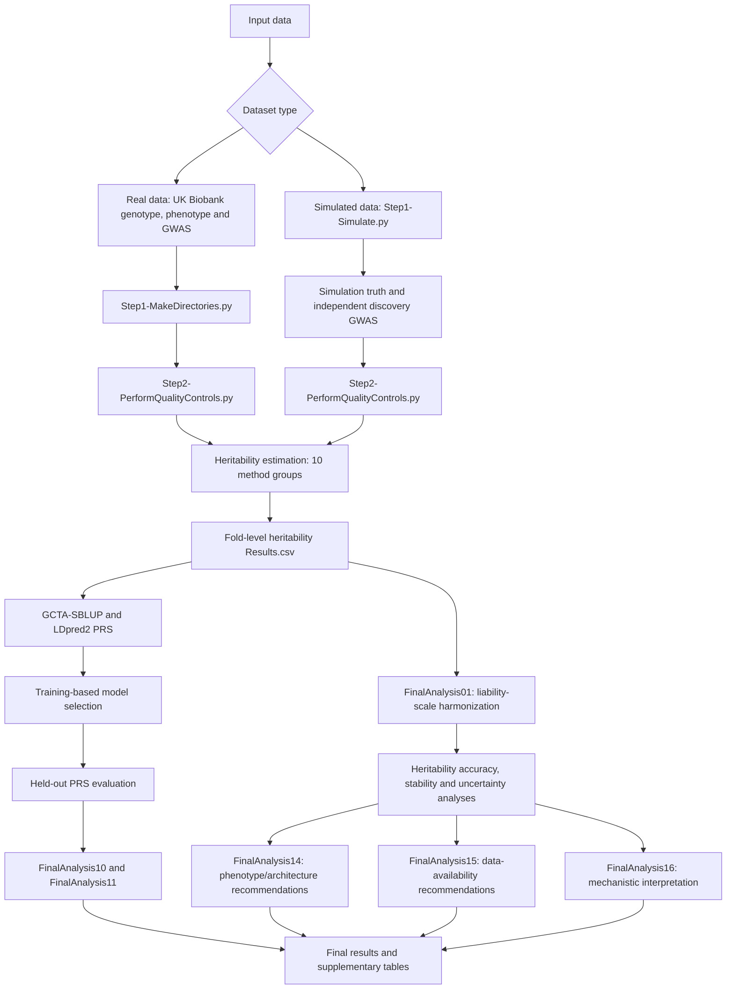

# Benchmarking Heritability Estimation Strategies Across 85 Configurations and Their Downstream Effect on Polygenic Risk Score Performance

**A reproducible computational framework for comparing SNP heritability estimation methods, evaluating their statistical properties, and investigating their downstream effects on polygenic risk score (PRS) performance.**

**Authors:** Muhammad Muneeb and David B. Ascher

**Publication:** [Associated arXiv preprint](https://arxiv.org/abs/2604.02394) · [DOI](https://doi.org/10.48550/arXiv.2604.02394)

**License:** [MIT](LICENSE)

This repository provides the scripts, parameter configurations, analysis procedures, and selected numerical outputs for benchmarking **10 heritability method groups comprising 85 configurations**. The benchmark includes 10 empirical UK Biobank phenotypes and 200 controlled simulated datasets, followed by downstream PRS modelling using GCTA-SBLUP and LDpred2.

The repository is organized around the order in which analyses are performed.

## Workflow overview



## 1. Installation and environment

### 1.1 Clone the repository

```bash
git clone https://github.com/MuhammadMuneeb007/Benchmarking-Heritability-Estimation-Strategies-Across-85-Configurations-and-Their-Downstream-Effect.git

cd Benchmarking-Heritability-Estimation-Strategies-Across-85-Configurations-and-Their-Downstream-Effect
```

All workflow commands below should normally be executed from the working directory containing the relevant Python scripts and dataset folders.

### 1.2 Python and R environments

The repository provides Conda environment files used to document the computational dependencies.

```bash
conda env create -f leopard-sdm.yml
conda activate leopard-sdm
```

For LDSC-related analyses:

```bash
conda env create -f ldsc.yml
```

The repository also retains `ldscc.yml` for the corresponding historical LDSC environment.

Depending on the installed software, additional environments may be needed for individual methods.

### 1.3 Required external tools

**Step-by-step download and placement instructions:** [External software and reference resources — official download links, required filenames, commands and directory layouts](REFERENCE_RESOURCES.md). This guide specifies where to obtain PLINK, GCTA, GEMMA, DPR, LDSC, LDAK, LDpred2 and the external LD-score/tagging files expected by the repository. The third-party datasets are linked rather than mirrored in GitHub.

| Tool | Purpose | Reference |
|---|---|---|
| PLINK 1.9 | Genotype handling, QC, clumping, pruning, PCA | [PLINK](https://www.cog-genomics.org/plink/) |
| GCTA | GRM-based heritability and SBLUP | [GCTA](https://yanglab.westlake.edu.cn/software/gcta/) |
| GEMMA | Variance-component and regression analyses | [GEMMA](https://github.com/genetics-statistics/GEMMA) |
| DPR | Relatedness modelling used with GEMMA | [DPR](https://github.com/biostatpzeng/DPR) |
| LDSC | LD score regression | [LDSC](https://github.com/bulik/ldsc) |
| LDAK / SumHer | Tagging-based heritability | [LDAK](https://dougspeed.com/) |
| LDpred2 / bigsnpr | Heritability estimation and PRS | [bigsnpr](https://privefl.github.io/bigsnpr/) |
| stdpopsim / msprime | Simulation of genotype data | [stdpopsim](https://popsim-consortium.github.io/stdpopsim-docs/stable/) |

Many existing scripts call executables using relative paths such as `./plink`, `./gcta`, `./gemma`, or `./ldak`, and LDSC scripts call `ldsc.py`. These executables and third-party source files must be installed or made available in the locations expected by each script.

Check their availability before running the corresponding analyses:

```bash
./plink --version
./gcta --version
./gemma -help
./ldak --help
```

Some tools use different version/help argument conventions. Consult the upstream documentation when necessary.

**Note:** The supplied environment YAML files document the software used in the project. They do not replace external reference datasets, PLINK genotype files, or UK Biobank access approval.

---

## 2. Real data: organize the input files

The real-data workflow uses genotype, phenotype, covariate, and GWAS summary-statistic information. Individual-level UK Biobank data are restricted and are not distributed in this repository.

### 2.1 Expected working-directory structure

```text
working_directory/
│
├── Step1-MakeDirectories.py
├── Step2-PerformQualityControls.py
├── Module1.R
│
├── genotypes.bed
├── genotypes.fam
├── genotypes.bim19
├── genotypes.bim38
├── phenotype_file.txt
│
├── asthma/
│   └── asthma.gz
│
├── body_mass_index_bmi/
│   └── body_mass_index_bmi.gz
│
└── ...
```

The root-level inputs have the following roles:

| File | Description |
|---|---|
| `genotypes.bed` | PLINK genotype data |
| `genotypes.fam` | Participant and phenotype metadata |
| `genotypes.bim19` | Genotype variant coordinates in GRCh37/hg19 |
| `genotypes.bim38` | Genotype variant coordinates in GRCh38/hg38 |
| `phenotype_file.txt` | Phenotype and covariate table |
| `<phenotype>/<phenotype>.gz` | Standardized GWAS summary statistics |

The repository's current `Step1-MakeDirectories.py` expects specific columns from the project phenotype file, including `ID`, `sex`, `fasting_time`, and the requested phenotype. The exact phenotype/covariate schema must be prepared before invoking it.

### 2.2 Standardize GWAS summary statistics

The heritability scripts expect the standardized GWAS format used by this benchmark, including:

```text
CHR  BP  SNP  A1  A2  N  SE  P  BETA  INFO  MAF
```

Relevant fields include variant coordinates, alleles, sample size, effect estimate, standard error, association P-value, imputation INFO, and minor allele frequency.

For binary phenotypes represented by odds ratios, the corresponding log-odds effect must be derived appropriately.

The genomic build and allele representation should be checked against the genotype data before analysis.

### 2.3 Prepare a real phenotype

For example, to prepare BMI:

```bash
mkdir -p body_mass_index_bmi

python Step1-MakeDirectories.py body_mass_index_bmi
```

The script compares GWAS and genotype variant matches using the available genome-build-specific BIM files, selects the appropriate BIM representation, and prepares phenotype-specific genotype, covariate, and phenotype files.

The expected outputs are:

```text
body_mass_index_bmi/
├── body_mass_index_bmi.bed
├── body_mass_index_bmi.bim
├── body_mass_index_bmi.fam
├── body_mass_index_bmi.cov
├── body_mass_index_bmi.height
└── body_mass_index_bmi.gz
```

**Parameters**

```bash
python Step1-MakeDirectories.py <phenotype>
```

| Parameter | Description | Example |
|---|---|---|
| `phenotype` | Phenotype name matching the directory and phenotype column | `body_mass_index_bmi` |

The script does not currently expose additional named CLI options.

### 2.4 Real phenotypes included in the benchmark

The final empirical analyses cover:

```text
asthma
body_mass_index_bmi
depression
gastro_oesophageal_reflux_gord_gastric_reflux
high_cholesterol
hypertension
hypothyroidism_myxoedema
irritable_bowel_syndrome
migraine
osteoarthritis
```

BMI is treated as a continuous phenotype in the downstream PRS workflow; the remaining listed phenotypes are treated as binary in the current PRS analysis scripts.

---

## 3. Real data: quality control and five-fold preparation

### 3.1 Run quality control

For BMI:

```bash
python Step2-PerformQualityControls.py body_mass_index_bmi
```

For asthma:

```bash
python Step2-PerformQualityControls.py asthma
```

**Command syntax**

```bash
python Step2-PerformQualityControls.py <dataset>
```

| Parameter | Description |
|---|---|
| `dataset` | Name of the prepared phenotype directory |

The current public script uses internally defined QC, clumping and pruning settings rather than CLI flags for those thresholds.

Its workflow includes GWAS/genotype matching, genotype QC, phenotype/covariate processing and the creation of five train/test folds.

### 3.2 Expected output

```text
body_mass_index_bmi/
│
├── Fold_0/
│   ├── train_data.bed
│   ├── train_data.bim
│   ├── train_data.fam
│   ├── train_data.cov
│   ├── train_data.QC.bed
│   ├── train_data.QC.bim
│   ├── train_data.QC.fam
│   ├── test_data.bed
│   ├── test_data.bim
│   ├── test_data.fam
│   └── test_data.cov
│
├── Fold_1/
├── Fold_2/
├── Fold_3/
└── Fold_4/
```

These files provide the input for individual-level heritability estimators and downstream PRS calculations.

The main objective is to estimate heritability using the designated training data and subsequently assess PRS prediction on held-out data.

**One QC script for binary and continuous phenotypes.** `Step2-PerformQualityControls.py` is used for both phenotype types; no separate binary-specific QC script is required for the workflow documented here. The script uses stratified five-fold cross-validation when the post-QC PLINK `.fam` phenotype values are exactly `{1, 2}` (binary case/control coding) and standard shuffled five-fold cross-validation otherwise (continuous phenotypes). Both branches use `random_state=42`. The GWAS `MAF > 0.01` and `INFO > 0.8` filter line is currently commented out in this script, so apply the relevant GWAS quality filters to the input summary statistics upstream if those thresholds are required.

---

## 4. Simulated data: generate genotypes, phenotypes and independent GWAS

The simulation workflow is implemented in:

[`Step1-Simulate.py`](Step1-Simulate.py)

This script produces the simulated datasets and records the known heritability-generating parameters. It does **not** estimate heritability using GCTA, GEMMA, LDSC, LDAK, or LDpred2.

### 4.1 Simulation design

| Parameter | Default design |
|---|---|
| Population model | OutOfAfrica_3G09 |
| Population | CEU |
| Genome representation | GRCh38/HapMapII genetic map |
| Chromosomes | 1–22 |
| Simulated segment | Central 10 Mb per chromosome |
| Final genotype panel | 100,000 common SNPs |
| Master population | 15,000 |
| Independent discovery GWAS cohort | 10,000 |
| Large target cohort | 5,000 |
| Small target cohort | 750 |
| Trait types | Continuous and binary |
| Generating heritability | 0.05, 0.10, 0.30, 0.50, 0.70 |
| Causal SNP counts | 100 and 5,000 |
| Replicates | 5 |
| Target datasets | 200 |
| Cross-validation folds | 5 |
| Binary population prevalence | 0.10 |

The design has 100 unique simulated traits evaluated at two target sample sizes, yielding 200 `SimXXX` datasets.

The discovery GWAS and target cohorts are non-overlapping. The target sample of 750 is nested within the target cohort of 5,000.

### 4.2 Generate simulated data

From an appropriately prepared working directory:

```bash
python Step1-Simulate.py
```

An explicit output root can also be supplied:

```bash
python Step1-Simulate.py \
    --root /path/to/simulation_work
```

To specify the PLINK executable:

```bash
python Step1-Simulate.py \
    --root /path/to/simulation_work \
    --plink /path/to/plink
```

To create separate physical genotype copies and materialize all fold-level genotype files:

```bash
python Step1-Simulate.py \
    --root /path/to/simulation_work \
    --plink /path/to/plink \
    --copy-genotypes \
    --materialize-folds \
    --keep-intermediates
```

The last command requires substantially more storage. The default approach uses shared genotype panels and hard links where applicable.

### 4.3 Available simulation parameters

| CLI argument | Default | Function |
|---|---|---|
| `--root` | `.` | Directory in which simulated datasets are created |
| `--plink` | Auto-detection | Explicit PLINK 1.9 executable |
| `--copy-genotypes` | Off | Copy genotype files instead of using hard links |
| `--materialize-folds` | Off | Materialize train/test PLINK files for each fold |
| `--keep-intermediates` | Off | Keep simulation intermediates |

Other simulation-design constants, such as target sample sizes, generating heritability, causal variant counts, chromosome segments and random seeds, are defined in `Step1-Simulate.py` itself. They are **not currently exposed as command-line flags**.

### 4.4 Generated files

The simulation creates directories of the form:

```text
Sim001/
├── Sim001.bed
├── Sim001.bim
├── Sim001.fam
├── Sim001.cov
├── Sim001.height
├── Sim001.gz
├── truth.json
├── fold_assignments.csv
├── simulated_phenotype.tsv
├── ...
├── Fold_0/
├── Fold_1/
├── Fold_2/
├── Fold_3/
└── Fold_4/
```

Important files include:

| File | Description |
|---|---|
| `truth.json` | Generating parameters and known heritability information |
| `SimXXX.gz` | GWAS summary statistics from the independent discovery cohort |
| `SimXXX.bed/.bim/.fam` | Target genotype data |
| `SimXXX.height` | Target phenotype |
| `SimXXX.cov` | Covariates |
| `fold_assignments.csv` | Recorded five-fold allocation |
| `simulated_phenotype.tsv` | Simulated phenotype and genetic/environmental components |

The script also generates a root-level `simulation_manifest.csv`, `simulation_truth_summary.csv`, and parameter files.

### 4.5 Inspect a simulation

```bash
cat Sim001/truth.json

zcat Sim001/Sim001.gz | head

head Sim001/fold_assignments.csv
```

### 4.6 Simulated-data quality control

```bash
python Step2-PerformQualityControls.py Sim001
```

Inspect its outputs:

```bash
ls Sim001/Fold_0/

ls Sim001/Fold_0/train_data.QC.*
```

The QC script prepares the final genotype data required by the heritability methods. Check the generated fold membership against `fold_assignments.csv` when reproducing the predefined simulation design.

### 4.7 Summarize simulated-data characteristics

```bash
python Step2-DataCharacteristic.py
```

Outputs include:

```text
Step2_Simulated_Data_Characteristics_Table_S8.csv
Step2_Simulated_Data_Characteristics_All200.csv
```

These summaries document the generated datasets, sample sizes, phenotype types, prevalence characteristics, variant counts and related simulation metadata.

**Working-directory recommendation:** Use separate real-data and simulation working copies. `Step1-Simulate.py` writes root-level `PhenotypeParameters.txt`, `FoldParameters.txt`, and related files, so running it in a working copy already configured for real-data SLURM arrays may overwrite those parameter lists.

---

## 5. Heritability estimation: 10 method groups and 85 configurations

Heritability estimation is the central benchmarking stage.

The same core configuration framework is applied across relevant datasets and cross-validation folds, subject to method-specific data and reference requirements.

### 5.1 Method overview

| Method group | Estimator/workflow | Configuration count | Python script |
|---|---|---:|---|
| 1 | LDpred2-based heritability | 4 | `Method1.py` |
| 2 | GCTA | 6 | `Method2.py` |
| 3 | GEMMA variance-component models | 24 | `Method3.py` |
| 4 | GEMMA with GWAS input | 6 | `Method4.py` |
| 5 | LDSC + GEMMA | 3 | `Method5.py` |
| 6 | DPR + GEMMA | 24 | `Method6.py` |
| 7 | LDSC with external LD reference | 4 real-data configurations | `Method7.py` |
| 8 | LDAK with calculated tagging | 7 | `Method8-Calculated.py` |
| 9 | LDAK with precomputed tagging | 6 | `Method8-Precomputed.py` |
| 10 | LDSC with genotype-derived reference | 1 | `Method10.py` |

**Total for the empirical design: 85 configurations.**

**Configuration accounting: 85 empirical → 82 nominal simulated → 78 evaluated simulated configurations.** The empirical benchmark contains 85 distinct configurations across 10 heritability method groups. For simulation, `Method7-Sim.py` uses one fixed LDSC simulation reference (`LDSCFILES_SIM/Reference5000/`), whereas the empirical `Method7.py` evaluates four combinations of LDSC reference LD scores and regression weights. This reduces the nominal simulation configuration grid by three, from 85 to **82**.

The archived **known-truth simulation accuracy comparisons evaluate 78 configurations across nine method groups**, not all 82 nominal combinations. The remaining four correspond to the `LDpred-2-Heritability` group, which has four configurations in the empirical benchmark but **no evaluable entries in the archived simulated accuracy summaries**. They are therefore absent from the 78-configuration comparisons; this should not be interpreted as evidence that those configurations failed or as an estimate of their simulated accuracy. The Friedman tests and related paired configuration rankings described in the manuscript and Supplementary Material 2 use these **78 evaluated configurations**. See [`results/FinalAnalysis04-XX/FinalAnalysis04-XX_configuration_summary.csv`](results/FinalAnalysis04-XX/FinalAnalysis04-XX_configuration_summary.csv) and [`results/FinalAnalysis04-XX/FinalAnalysis04-XX_method_summary.csv`](results/FinalAnalysis04-XX/FinalAnalysis04-XX_method_summary.csv) for the exact analyzed set.

The scripts perform configuration sweeps using settings defined internally. A command such as `python Method2.py asthma 0` runs the configurations implemented by Method 2; it does not select a single configuration unless the code is explicitly modified.

### 5.2 Common command syntax

Most estimation scripts follow:

```bash
python <script.py> <dataset> <fold>
```

| Parameter | Allowed form | Description |
|---|---|---|
| `dataset` | Dataset directory name | Example: `asthma` or `Sim001` |
| `fold` | `0`, `1`, `2`, `3`, `4` | Target cross-validation fold |

Method 7 is an exception for real data: `Method7.py` uses only the dataset argument and writes the corresponding results to all five folds.

### 5.3 Method 1 — LDpred2 heritability

```bash
python Method1.py asthma 0

python Method1.py Sim001 0
```

The method evaluates the LDpred2 heritability configurations implemented in `Method1.py`, including the full-variant and HapMap-based variants and clumping/pruning alternatives.

The R implementation is supplied in:

```text
LDpred-2-Heritability.R
```

### 5.4 Method 2 — GCTA

```bash
python Method2.py asthma 0

python Method2.py Sim001 0
```

The six configurations cover genotype-only, genotype plus covariates, and genotype plus covariates and principal components, with clumping/pruning alternatives.

This method also creates the GWAS input used by the GCTA-SBLUP PRS workflow.

### 5.5 Method 3 — GEMMA

```bash
python Method3.py asthma 0

python Method3.py Sim001 0
```

The configurations combine relatedness-matrix parameterizations, heritability algorithms, covariate specifications and clumping/pruning options.

### 5.6 Method 4 — GEMMA with GWAS input

```bash
python Method4.py asthma 0

python Method4.py Sim001 0
```

This implementation uses the GWAS-based workflow defined in `Method4.py` and evaluates six configurations.

### 5.7 Method 5 — LDSC + GEMMA

```bash
python Method5.py asthma 0

python Method5.py Sim001 0
```

This method combines LD-score-related preprocessing with the GEMMA estimation workflow.

The required LDSC installation and LD score inputs must be accessible to the script.

### 5.8 Method 6 — DPR + GEMMA

```bash
python Method6.py asthma 0

python Method6.py Sim001 0
```

The script benchmarks the DPR-derived relatedness workflow and the GEMMA estimation variants, giving 24 configurations.

### 5.9 Method 7 — LDSC with external reference

For real data:

```bash
python Method7.py asthma
```

The real-data script evaluates the combinations of:

```text
eur_ref_ld_chr
eur_w_ld_chr
```

as reference LD scores and regression weights.

Reference resources must be available under the directory structure expected by the code (see [reference download and placement instructions](REFERENCE_RESOURCES.md#2-european-ldsc-ld-score-reference-files-empirical-method-7)):

```text
LDSCFILES/
├── eur_ref_ld_chr/
└── eur_w_ld_chr/
```

For simulated data:

```bash
python Method7-Sim.py Sim001 0
```

The simulated implementation requires:

```text
LDSCFILES_SIM/Reference5000/
```

with chromosome-specific LD-score and associated `.M` and `.M_5_50` files.

**Parameters**

```bash
python Method7.py <dataset>
python Method7-Sim.py <dataset> [fold]
```

The simulated script defaults the fold argument to `0` if omitted.

### 5.10 Method 8 — LDAK with calculated tagging

```bash
python Method8-Calculated.py asthma 0

python Method8-Calculated.py Sim001 0
```

The script computes tagging representations from genotype data and estimates heritability across the implemented LDAK tagging-model variants.

### 5.11 Method 9 — LDAK with precomputed tagging

The ninth heritability method group uses the following filenames in this repository:

```bash
python Method8-Precomputed.py asthma 0

python Method8-Precomputed-Sim.py Sim001 0
```

The filenames retain the original implementation naming, although this workflow represents **Method 9 in the benchmark table**.

Real-data tagging inputs are expected under (see [official provider links and download commands](REFERENCE_RESOURCES.md#3-ldak-precomputed-tagging-files-empirical-method-9)):

```text
LDAKFILES/
```

The six empirical precomputed tagging files are:

```text
bld.ldak.hapmap.gbr.tagging
ldak.thin.hapmap.gbr.tagging
bld.ldak.lite.alpha.hapmap.gbr.tagging
bld.ldak.genotyped.gbr.tagging
ldak.thin.genotyped.gbr.tagging
bld.ldak.lite.alpha.genotyped.gbr.tagging
```

Simulated tagging files are expected under:

```text
LDAKFILES_SIM/Reference5000/
```

The simulated code references:

```text
sim_human.tagging
sim_gcta.tagging
sim_alpha_1.0.tagging
sim_alpha_0.5.tagging
sim_alpha_0.0.tagging
sim_alpha_-0.5.tagging
```

These reference files are external workflow dependencies and are not included in the public repository. See [simulation reference generation and expected paths](REFERENCE_RESOURCES.md#4-simulation-specific-reference-resources-not-distributed).

### 5.12 Method 10 — LDSC with genotype-derived reference

Real-data example:

```bash
python Method10.py asthma 0
```

Simulated-data example:

```bash
python Method10-Sim.py Sim001 0
```

This workflow derives LD scores from genotype data according to the script-defined procedures and applies LDSC to estimate heritability.

### 5.13 Run all method groups for one dataset

For a real phenotype:

```bash
DATASET=asthma

# LDSC with external reference is dataset-level.
python Method7.py "$DATASET"

# Remaining methods are fold-level.
for FOLD in 0 1 2 3 4; do
    python Method1.py "$DATASET" "$FOLD"
    python Method2.py "$DATASET" "$FOLD"
    python Method3.py "$DATASET" "$FOLD"
    python Method4.py "$DATASET" "$FOLD"
    python Method5.py "$DATASET" "$FOLD"
    python Method6.py "$DATASET" "$FOLD"
    python Method8-Calculated.py "$DATASET" "$FOLD"
    python Method8-Precomputed.py "$DATASET" "$FOLD"
    python Method10.py "$DATASET" "$FOLD"
done
```

For simulated data:

```bash
DATASET=Sim001

for FOLD in 0 1 2 3 4; do
    python Method1.py "$DATASET" "$FOLD"
    python Method2.py "$DATASET" "$FOLD"
    python Method3.py "$DATASET" "$FOLD"
    python Method4.py "$DATASET" "$FOLD"
    python Method5.py "$DATASET" "$FOLD"
    python Method6.py "$DATASET" "$FOLD"
    python Method7-Sim.py "$DATASET" "$FOLD"
    python Method8-Calculated.py "$DATASET" "$FOLD"
    python Method8-Precomputed-Sim.py "$DATASET" "$FOLD"
    python Method10-Sim.py "$DATASET" "$FOLD"
done
```

These are workflow examples, not a recommendation to run all methods sequentially on a login node. Estimation can be computationally intensive and should be submitted using appropriate HPC resources and the environments required by each method.

The repository also provides Slurm launchers (`Method*.sh`), but some contain project-specific partitions, dataset selections, array definitions and environment assumptions. Review these values for your computing environment before submission.

### 5.14 Heritability output format

Each method writes a configuration-level result table, normally under:

```text
<dataset>/Fold_<fold>/<method-directory>/Results.csv
```

A representative output directory is:

```text
Sim001/
└── Fold_0/
    ├── LDpred-2-Heritability/
    │   └── Results.csv
    ├── GCTA-Heritability/
    │   └── Results.csv
    ├── Gemma1-Heritability/
    │   └── Results.csv
    ├── Gemma2-Heritability/
    │   └── Results.csv
    ├── DPR-Gemma-Heritability/
    │   └── Results.csv
    ├── LDSC-Heritability/
    │   └── Results.csv
    ├── LDAK-Calculated-Heritability/
    │   └── Results.csv
    └── LDAK-Precomputed-Heritability/
        └── Results.csv
```

The complete benchmark also contains the other method directories described above.

Typical output columns include:

```text
h2model
h2
h2_se
clumpprune
numberofvariants
numberofpca
```

Some methods write additional configuration parameters.

---

## 6. Heritability postprocessing and accuracy analysis

Once the fold-level heritability estimates are available, the downstream analyses standardize the results and assess their statistical behaviour.

### 6.1 Liability-scale harmonization

```bash
python FinalAnalysis01-LiabilityScale.py real

python FinalAnalysis01-LiabilityScale.py simulated
```

**Parameters**

```bash
python FinalAnalysis01-LiabilityScale.py <mode>
```

| Parameter | Options |
|---|---|
| `mode` | `real`, `simulated` |

For a custom working root:

```bash
HERITABILITY_REAL_ROOT=/path/to/real_work \
python FinalAnalysis01-LiabilityScale.py real
```

```bash
HERITABILITY_SIM_ROOT=/path/to/simulation_work \
python FinalAnalysis01-LiabilityScale.py simulated
```

Parallelism can be adjusted with `LIABILITY_WORKERS`.

The script creates `Results_Liability.csv` alongside the relevant fold-level estimation results and saves master tables to:

```text
FinalAnalysis_Liability/
```

These harmonized values are used for subsequent analyses involving binary-trait liability-scale estimates.

### 6.2 Horizontal summaries

```bash
python FinalAnalysis02-Horizontal.py real

python FinalAnalysis02-Horizontal.py simulated
```

Valid mode arguments are `real` and `simulated`, with `real` as the default.

Main output:

```text
FinalAnalysis02/
```

Archived numerical tables are available under [`results/FinalAnalysis02/`](results/FinalAnalysis02/).

### 6.3 Liability prevalence sensitivity

```bash
python FinalAnalysis03-LiabilitySensitivity.py real

python FinalAnalysis03-LiabilitySensitivity.py simulated
```

This analysis examines the dependence of binary-trait liability-scale estimates on prevalence assumptions.

Main output:

```text
FinalAnalysis03/
```

Archived real-data sensitivity tables are available under [`results/FinalAnalysis03/`](results/FinalAnalysis03/).

### 6.4 One-factor matched comparisons

```bash
python FinalAnalysis04-OneFactorMatched.py real

python FinalAnalysis04-OneFactorMatched.py simulated

python FinalAnalysis04-OneFactorMatched.py both
```

**Parameter**

```bash
python FinalAnalysis04-OneFactorMatched.py <mode>
```

Valid values are `real`, `simulated` and `both`.

This analysis examines controlled comparisons that change a single modelling factor while matching eligible input conditions.

The results are written under:

```text
FinalAnalysis04/
```

Archived tables are available under [`results/FinalAnalysis04/`](results/FinalAnalysis04/).

### 6.5 Known-truth simulation accuracy and empirical comparison

```bash
python FinalAnalysis05-Accuracy.py
```

To specify the analysis root:

```bash
HERITABILITY_ROOT=/path/to/working_directory \
python FinalAnalysis05-Accuracy.py
```

The script analyses heritability estimation accuracy against the recorded simulation truth and uses separate empirical reference comparisons where available.

Outputs are written under:

```text
FinalAnalysis04-XX/
```

The archived results are provided under [`results/FinalAnalysis04-XX/`](results/FinalAnalysis04-XX/).

Important files include:

```text
FinalAnalysis04-XX_units.csv
FinalAnalysis04-XX_configuration_summary.csv
FinalAnalysis04-XX_method_summary.csv
FinalAnalysis04-XX_top_accuracy.csv
FinalAnalysis04-XX_method_pairwise.csv
FinalAnalysis04-XX_global_tests.csv
```

These files allow researchers to examine performance differences by method, phenotype type, target sample size, generating heritability and genetic architecture.

### 6.6 Uncertainty, reliability and stability

```bash
python FinalAnalysis06-UncertanityReliability.py
```

Specify the root if necessary:

```bash
HERITABILITY_ROOT=/path/to/working_directory \
python FinalAnalysis06-UncertanityReliability.py
```

This analysis evaluates cross-fold variability, uncertainty availability, estimates outside the conventional 0–1 range, convergence information and sample-size-related stability.

Its main outputs are written to:

```text
FinalAnalysis06-UncertaintyReliability/
```

Results are archived under [`results/FinalAnalysis06-UncertaintyReliability/`](results/FinalAnalysis06-UncertaintyReliability/).

The exact Python filename retains the repository's original spelling, `UncertanityReliability.py`.

### 6.7 Figures and additional result summaries

The following scripts generate the corresponding visualizations and summaries from analysis outputs:

```bash
python FinalAnalysis07-Figures.py

python FinalAnalysis07-FiguresTables-Uncertainty.py

python FinalAnalysis09-FinalAnalysis.py

python FinalAnalysis12-FigureHeatmap.py

python FinalAnalysis13-FigureHeatmap.py
```

Their outputs are associated with directories such as:

```text
FinalAnalysis07-HorizontalUncertainty/
FinalAnalysis08-PrimaryFigures-Uncertainty/
FinalFigures-Heritability-Uncertainty/
```

Archived figures and tables are located in the matching `results/` directories.

Some figure scripts require the full `FinalAnalysis06_raw_scale_rows.csv` intermediate table, which is not present in the compact public results archive. This file can be regenerated by running `FinalAnalysis06-UncertanityReliability.py` on the underlying fold-level results.

---

## 7. Polygenic risk score calculation

The next stage evaluates whether the heritability estimation method and configuration influence downstream PRS prediction.

Two PRS methods are implemented:

1. **GCTA-SBLUP**
2. **LDpred2**

The PRS workflows use eligible positive heritability estimates below one and evaluate prediction on training and held-out test data.

### 7.1 PRS model configurations

The final scripts evaluate prediction using:

- PRS only
- Covariates without PRS (null model)
- PRS combined with covariates (full model)

For binary phenotypes, the reported performance measure is ROC-AUC. For continuous phenotypes, the evaluation uses R².

PRS hyperparameters are selected using the training results; the corresponding test result is then evaluated for the selected setting.

### 7.2 GCTA-SBLUP PRS

The main implementation is:

[`GCTA-PRS-Final.py`](GCTA-PRS-Final.py)

**Command syntax**

```bash
python GCTA-PRS-Final.py \
    <dataset> \
    <fold> \
    <config_index> \
    <binary|continuous> \
    <h2> \
    <method> \
    <h2model> \
    <clumpprune> \
    <numberofpca>
```

| Argument | Description |
|---|---|
| `dataset` | Real phenotype or simulation directory |
| `fold` | Cross-validation fold, 0–4 |
| `config_index` | Configuration index for the fold-level PRS output |
| `binary\|continuous` | Phenotype type |
| `h2` | Heritability estimate supplied to PRS; must be strictly between 0 and 1 |
| `method` | Source heritability method |
| `h2model` | Source heritability configuration label |
| `clumpprune` | Clumping/pruning label, normally `yes` or `no` |
| `numberofpca` | Number of principal components |

Example command structure:

```bash
python GCTA-PRS-Final.py \
    Sim001 0 0 continuous 0.30 \
    GCTA-Heritability GCTA_genotype yes 6
```

The value `0.30` here is an illustrative input. To reproduce an actual benchmark configuration, replace it and the configuration identifiers with the values recorded in the corresponding fold-level heritability `Results.csv`.

**Output**

```text
<dataset>/Fold_<fold>/GCTA-SBLUP-PRS/<configuration>/Results.csv
```

### 7.3 LDpred2 PRS — simulated datasets

The simulation implementation uses:

```text
LDpred-2-PRS-Final-cached.py
LDpred-2-PRS-Final-cached.R
```

**Command syntax**

```bash
python LDpred-2-PRS-Final-cached.py \
    <dataset> \
    <fold> \
    <config_index> \
    <binary|continuous> \
    <h2> \
    <method> \
    <h2model> \
    <clumpprune> \
    <numberofpca>
```

Example structure:

```bash
python LDpred-2-PRS-Final-cached.py \
    Sim001 0 0 continuous 0.30 \
    GCTA-Heritability GCTA_genotype yes 6
```

Use the actual h² and configuration identity when reproducing an observed benchmark row.

**Output**

```text
<dataset>/Fold_<fold>/LDpred2-PRS-v2/<configuration>/Results.csv
```

### 7.4 LDpred2 PRS — real datasets

For real-data analysis:

```bash
python LDpred-2-PRS-Final-real-updated.py \
    <dataset> \
    <fold> \
    <config_index> \
    <binary|continuous> \
    <h2> \
    <method> \
    <h2model> \
    <clumpprune> \
    <numberofpca>
```

The Python implementation calls:

```text
LDpred-2-PRS-Final-real-updated.R
```

**Output**

```text
<dataset>/Fold_<fold>/LDpred2-PRS-Updated/<configuration>/Results.csv
```

The two LDpred2 R workers are included in the repository.

### 7.5 Run PRS workflows with Slurm

The repository contains launchers that read the fold-level heritability results and construct the individual configuration calls.

Create the logging directory before submitting the jobs:

```bash
mkdir -p logs
```

**Real-data GCTA-SBLUP**

```bash
sbatch --array=1-10 GCTA-Real-ALL.sh
```

**Simulated-data GCTA-SBLUP**

```bash
sbatch --array=1-200 GCTA-RPS-Final-simulated-ALL.sh
```

**Real-data LDpred2**

```bash
sbatch --array=1-10 LDpred2-Real-Updated-ALL.sh
```

**Simulated-data LDpred2**

```bash
sbatch --array=1-200 LDpred2-PRS-Simulated-ALL.sh
```

These Slurm array ranges correspond to the dataset selections defined in the supplied launchers.

Before execution on a different system, update the project-specific working-directory line, such as:

```bash
cd /data/ascher01/uqmmune1/finalheritability
```

to the appropriate path for that system, and review the partition, memory, time, and Conda activation directives.

These launchers are designed for the original HPC workflow and should not be assumed to be portable without checking their configuration.

### 7.6 BMI PRS-only postprocessing

The repository provides two scripts used for correcting the PRS-only R² evaluation for BMI:

```bash
python FixBMI-PRSOnly.py

python FixBMI-LDpred2-Updated.py
```

Both work with the project-specific `body_mass_index_bmi` directory and do not accept additional CLI options.

Run them only when processing the corresponding BMI PRS outputs, and preserve the original results and correction provenance.

---

## 8. Final PRS performance and heritability–PRS association analyses

The two principal scripts are:

```text
FinalAnalysis10-PRSDesign.py
FinalAnalysis11-PRS-Correlation-FDR.py
```

They read fold-level PRS results from the existing dataset directories.

### 8.1 Inspect the PRS experimental design

```bash
python FinalAnalysis10-PRSDesign.py
```

The script summarizes available configurations and PRS analyses, including real/simulated dataset coverage and comparisons between the two PRS methods.

Parallel file scanning can be configured using the environment variable `PRS_THREADS`:

```bash
PRS_THREADS=16 python FinalAnalysis10-PRSDesign.py
```

### 8.2 Run the final PRS analysis

```bash
python FinalAnalysis11-PRS-Correlation-FDR.py
```

To use 16 file-scanning workers:

```bash
PRS_THREADS=16 python FinalAnalysis11-PRS-Correlation-FDR.py
```

The current script writes its CSV outputs into the **current working directory**. The final archive stores selected copies under [`results/prs/`](results/prs/).

The analysis includes fold-level training-based parameter selection, configuration-level aggregation, predictive-performance summaries, dataset-specific correlations, FDR adjustments, random-effects meta-analysis and phenotype-type contrasts.

### 8.3 Final PRS result files

| File | Description |
|---|---|
| [`BestTrain_FoldLevel_SelectedResults.csv`](results/prs/BestTrain_FoldLevel_SelectedResults.csv) | Fold-level selected PRS results |
| [`BestTrain_ConfigLevel_Values_Used_For_Correlations.csv`](results/prs/BestTrain_ConfigLevel_Values_Used_For_Correlations.csv) | Configuration-level heritability and PRS values |
| [`BestTrain_MultiLevel_Performance_Summary.csv`](results/prs/BestTrain_MultiLevel_Performance_Summary.csv) | Predictive-performance summaries |
| [`BestTrain_MultiLevel_DatasetSpecific_Correlations_FDR.csv`](results/prs/BestTrain_MultiLevel_DatasetSpecific_Correlations_FDR.csv) | Dataset-specific Pearson/Spearman associations |
| [`BestTrain_MultiLevel_Master_Summary.csv`](results/prs/BestTrain_MultiLevel_Master_Summary.csv) | Main multi-level association summary |
| [`BestTrain_MultiLevel_Group_MetaAnalysis_FDR.csv`](results/prs/BestTrain_MultiLevel_Group_MetaAnalysis_FDR.csv) | Random-effects meta-analysis |
| [`BestTrain_MultiLevel_Binary_vs_Continuous_Contrasts_FDR.csv`](results/prs/BestTrain_MultiLevel_Binary_vs_Continuous_Contrasts_FDR.csv) | Binary/continuous contrasts |
| [`BestTrain_MultiLevel_TestEndpoint_Diagnostic.csv`](results/prs/BestTrain_MultiLevel_TestEndpoint_Diagnostic.csv) | Test-endpoint diagnostic comparisons |
| [`Dataset_PhenotypeType_Classification.csv`](results/prs/Dataset_PhenotypeType_Classification.csv) | Dataset classification |
| [`ModelLevel_Performance_Availability.csv`](results/prs/ModelLevel_Performance_Availability.csv) | PRS result availability |

These files are already available in the public repository and can be inspected without rerunning the upstream PRS calculations.

---

## 9. Practical method recommendations by phenotype architecture

[`FinalAnalysis14-DataClassificationAndPerformance.py`](FinalAnalysis14-DataClassificationAndPerformance.py) provides simulation-based recommendations according to the properties of the simulated dataset.

The analysis uses known-truth estimation errors and evaluates combinations of phenotype type, target sample size, generating heritability and causal-variant architecture.

### 9.1 Run the analysis using archived results

```bash
python FinalAnalysis14-DataClassificationAndPerformance.py \
    --input results/FinalAnalysis04-XX/FinalAnalysis04-XX_units.csv \
    --output FinalAnalysis14-DataClassificationAndPerformance \
    --bootstrap 2000 \
    --seed 20261022
```

### 9.2 Available parameters

| Parameter | Default | Meaning |
|---|---|---|
| `--input` | `FinalAnalysis04-XX/FinalAnalysis04-XX_units.csv` | Analysis-unit data |
| `--output` | `FinalAnalysis14-DataClassificationAndPerformance` | Output directory |
| `--bootstrap` | `2000` | Number of bootstrap iterations |
| `--seed` | `20261022` | Random seed for bootstrap inference |

### 9.3 Outputs

```text
Table1_Simulated_BestMethods.csv
Table2_Simulated_BestConfigurations.csv
```

Archived versions are available in [`results/FinalAnalysis14/`](results/FinalAnalysis14/).

The available `FinalAnalysis14_DecisionTable.csv` is also retained as a separate archived decision-summary result.

Recommendations are conditional on the simulation settings and should not be interpreted as universally optimal across untested genetic architectures or cohort designs.

---

## 10. Practical recommendations by available data type

[`FinalAnalysis15-DataTypeClassification.py`](FinalAnalysis15-DataTypeClassification.py) classifies the data requirements for each heritability method and determines which method groups are feasible under different data-availability scenarios.

### 10.1 Generate the data-requirement tables

```bash
python FinalAnalysis15-DataTypeClassification.py
```

To set an explicit output directory:

```bash
python FinalAnalysis15-DataTypeClassification.py \
    --out FinalAnalysis15-DataTypeClassification
```

### 10.2 Generate optional simulation-based method rankings

```bash
python FinalAnalysis15-DataTypeClassification.py \
    --rank \
    --input results/FinalAnalysis04-XX/FinalAnalysis04-XX_units.csv \
    --scope band \
    --min-coverage 0.80 \
    --out FinalAnalysis15-DataTypeClassification
```

### 10.3 Available parameters

| Parameter | Default | Description |
|---|---|---|
| `--out` | `FinalAnalysis15-DataTypeClassification` | Output directory |
| `--rank` | Off | Enable simulation-based recommendation ranking |
| `--input` | `FinalAnalysis04-XX/FinalAnalysis04-XX_units.csv` | Accuracy data for optional ranking |
| `--scope` | `band` | `overall`, `band`, or `exact` |
| `--min-coverage` | `0.80` | Minimum eligible coverage for ranking |

### 10.4 Outputs

```text
Table1_MethodDataRequirements.csv
Table2_DataAvailabilityScenarios.csv
MethodScenarioFeasibilityMatrix.csv
```

With `--rank`, an additional file is generated:

```text
Optional_SimulationRecommendationsByDataAvailability.csv
```

The three standard output tables are archived under [`results/FinalAnalysis15/`](results/FinalAnalysis15/).

This stage helps researchers distinguish whether a method requires individual-level genotype data, GWAS summary statistics, external reference genotypes, precomputed LD scores or tagging information.

---

## 11. Mechanistic and matched-condition interpretation

[`FinalAnalysis16.py`](FinalAnalysis16.py) examines existing simulation results using matched-condition and method-family comparisons.

It provides additional interpretation of performance differences related to trait type, sample size, heritability architecture, causal SNP counts and method configuration.

### 11.1 Basic analysis using archived inputs

```bash
python FinalAnalysis16.py \
    --input results/FinalAnalysis04-XX/FinalAnalysis04-XX_units.csv
```

### 11.2 Analysis with additional available metadata

```bash
python FinalAnalysis16.py \
    --input results/FinalAnalysis04-XX/FinalAnalysis04-XX_units.csv \
    --grm-prefix /path/to/actual/grm/prefix \
    --effects /path/to/causal_effects.csv \
    --case-metadata /path/to/case_counts.csv \
    --population-prevalence 0.10 \
    --discovery-n 10000 \
    --gwas-snp-count 0 \
    --mean-ld-score 0 \
    --train-fraction 0.80
```

Only supply optional data paths when those files exist and have the fields expected by the script.

### 11.3 Available parameters

| Argument | Default | Function |
|---|---|---|
| `--input` | `FinalAnalysis04-XX/FinalAnalysis04-XX_units.csv` | Existing analysis-unit table |
| `--grm-prefix` | Empty | Existing GCTA GRM prefix |
| `--effects` | Empty | Optional causal-effect, MAF and LD information |
| `--case-metadata` | Empty | Optional case/sample-count metadata |
| `--population-prevalence` | `0.1` | Population prevalence assumption |
| `--discovery-n` | `10000` | Discovery GWAS sample size |
| `--gwas-snp-count` | `0` | Optional GWAS SNP count |
| `--mean-ld-score` | `0` | Optional empirical LD-score summary |
| `--train-fraction` | `0.8` | Training fraction |

Unlike FinalAnalysis14 and FinalAnalysis15, **FinalAnalysis16 is intentionally print-only**. It does not create new CSV tables or rerun the heritability estimators.

It distinguishes observations supported by the available simulation comparisons from mechanisms that would require additional model-specific or genotype-level evidence.

---

## 12. Analysis scripts: complete command reference

The following table provides the supported command interfaces of the major scripts in this repository.

Scripts without named CLI flags use their predefined internal configuration, filenames and constants.

| Script | Command format |
|---|---|
| `Step1-MakeDirectories.py` | `python Step1-MakeDirectories.py <phenotype>` |
| `Step2-PerformQualityControls.py` | `python Step2-PerformQualityControls.py <dataset>` |
| `Step1-Simulate.py` | `python Step1-Simulate.py [--root PATH] [--plink PATH] [--copy-genotypes] [--materialize-folds] [--keep-intermediates]` |
| `Step2-DataCharacteristic.py` | `python Step2-DataCharacteristic.py` |
| `Method1.py` | `python Method1.py <dataset> <fold>` |
| `Method2.py` | `python Method2.py <dataset> <fold>` |
| `Method3.py` | `python Method3.py <dataset> <fold>` |
| `Method4.py` | `python Method4.py <dataset> <fold>` |
| `Method5.py` | `python Method5.py <dataset> <fold>` |
| `Method6.py` | `python Method6.py <dataset> <fold>` |
| `Method7.py` | `python Method7.py <dataset>` |
| `Method7-Sim.py` | `python Method7-Sim.py <dataset> [fold]` |
| `Method8-Calculated.py` | `python Method8-Calculated.py <dataset> <fold>` |
| `Method8-Precomputed.py` | `python Method8-Precomputed.py <dataset> <fold>` |
| `Method8-Precomputed-Sim.py` | `python Method8-Precomputed-Sim.py <dataset> <fold>` |
| `Method10.py` | `python Method10.py <dataset> <fold>` |
| `Method10-Sim.py` | `python Method10-Sim.py <dataset> <fold>` |
| `FinalAnalysis01-LiabilityScale.py` | `python FinalAnalysis01-LiabilityScale.py <real\|simulated>` |
| `FinalAnalysis02-Horizontal.py` | `python FinalAnalysis02-Horizontal.py [real\|simulated]` |
| `FinalAnalysis03-LiabilitySensitivity.py` | `python FinalAnalysis03-LiabilitySensitivity.py [real\|simulated]` |
| `FinalAnalysis04-OneFactorMatched.py` | `python FinalAnalysis04-OneFactorMatched.py <real\|simulated\|both>` |
| `FinalAnalysis05-Accuracy.py` | `python FinalAnalysis05-Accuracy.py` |
| `FinalAnalysis06-UncertanityReliability.py` | `python FinalAnalysis06-UncertanityReliability.py` |
| `FinalAnalysis07-Figures.py` | `python FinalAnalysis07-Figures.py` |
| `FinalAnalysis07-FiguresTables-Uncertainty.py` | `python FinalAnalysis07-FiguresTables-Uncertainty.py` |
| `FinalAnalysis09-FinalAnalysis.py` | `python FinalAnalysis09-FinalAnalysis.py` |
| `GCTA-PRS-Final.py` | `python GCTA-PRS-Final.py <dataset> <fold> <config_index> <type> <h2> <method> <h2model> <clumpprune> <numberofpca>` |
| `LDpred-2-PRS-Final-cached.py` | Same nine positional arguments |
| `LDpred-2-PRS-Final-real-updated.py` | Same nine positional arguments |
| `FixBMI-PRSOnly.py` | `python FixBMI-PRSOnly.py` |
| `FixBMI-LDpred2-Updated.py` | `python FixBMI-LDpred2-Updated.py` |
| `FinalAnalysis10-PRSDesign.py` | `python FinalAnalysis10-PRSDesign.py` |
| `FinalAnalysis11-PRS-Correlation-FDR.py` | `python FinalAnalysis11-PRS-Correlation-FDR.py` |
| `FinalAnalysis12-FigureHeatmap.py` | `python FinalAnalysis12-FigureHeatmap.py` |
| `FinalAnalysis13-FigureHeatmap.py` | `python FinalAnalysis13-FigureHeatmap.py` |
| `FinalAnalysis14-DataClassificationAndPerformance.py` | `python FinalAnalysis14-DataClassificationAndPerformance.py [--input PATH] [--output PATH] [--bootstrap N] [--seed N]` |
| `FinalAnalysis15-DataTypeClassification.py` | `python FinalAnalysis15-DataTypeClassification.py [--out PATH] [--rank] [--input PATH] [--scope overall\|band\|exact] [--min-coverage FLOAT]` |
| `FinalAnalysis16.py` | `python FinalAnalysis16.py [--input PATH] [--grm-prefix PREFIX] [--effects PATH] [--case-metadata PATH] [--population-prevalence FLOAT] [--discovery-n N] [--gwas-snp-count N] [--mean-ld-score FLOAT] [--train-fraction FLOAT]` |

For scripts supporting `argparse`, use `--help` to inspect their available arguments:

```bash
python Step1-Simulate.py --help

python FinalAnalysis14-DataClassificationAndPerformance.py --help

python FinalAnalysis15-DataTypeClassification.py --help

python FinalAnalysis16.py --help
```

For legacy scripts driven directly by `sys.argv`, use the positional formats documented above. Do not assume those scripts implement `--help` or additional configurable CLI flags.

---

## 13. Archived results and figures

The [`results/`](results/) directory provides numerical tables, figures and selected supplementary outputs produced during the benchmark.

| Directory | Contents |
|---|---|
| [`results/FinalAnalysis_Liability/`](results/FinalAnalysis_Liability/) | Liability-scale harmonization |
| [`results/FinalAnalysis02/`](results/FinalAnalysis02/) | Horizontal heritability summaries |
| [`results/FinalAnalysis03/`](results/FinalAnalysis03/) | Prevalence sensitivity |
| [`results/FinalAnalysis04/`](results/FinalAnalysis04/) | One-factor matched comparisons |
| [`results/FinalAnalysis04-XX/`](results/FinalAnalysis04-XX/) | Accuracy and method/configuration comparisons |
| [`results/FinalAnalysis06-UncertaintyReliability/`](results/FinalAnalysis06-UncertaintyReliability/) | Uncertainty and reliability |
| [`results/FinalAnalysis07-HorizontalUncertainty/`](results/FinalAnalysis07-HorizontalUncertainty/) | Uncertainty figures |
| [`results/FinalAnalysis07-FiguresTables-Uncertainty/`](results/FinalAnalysis07-FiguresTables-Uncertainty/) | Manuscript uncertainty tables and figures |
| [`results/FinalAnalysis08-PrimaryFigures-Uncertainty/`](results/FinalAnalysis08-PrimaryFigures-Uncertainty/) | Main heritability visualizations |
| [`results/FinalFigures-Heritability-Uncertainty/`](results/FinalFigures-Heritability-Uncertainty/) | Final figure outputs |
| [`results/FinalAnalysis14/`](results/FinalAnalysis14/) | Phenotype/architecture recommendations |
| [`results/FinalAnalysis15/`](results/FinalAnalysis15/) | Method input requirements and feasible scenarios |
| [`results/prs/`](results/prs/) | Downstream PRS numerical results |

The archived results are distinct from the scripts' native output directories.

For example, the current PRS analysis writes `BestTrain_*.csv` files into its execution directory, while the repository stores its selected final numerical outputs under `results/prs/`.

Similarly, the full simulation-accuracy script writes to `FinalAnalysis04-XX/`, while the public archive contains selected files under `results/FinalAnalysis04-XX/`.

### 13.1 Inspect known-truth accuracy without rerunning simulations

```bash
head results/FinalAnalysis04-XX/FinalAnalysis04-XX_configuration_summary.csv

head results/FinalAnalysis04-XX/FinalAnalysis04-XX_method_summary.csv
```

### 13.2 Inspect PRS performance and correlations

```bash
head results/prs/BestTrain_MultiLevel_Performance_Summary.csv

head results/prs/BestTrain_MultiLevel_Master_Summary.csv

head results/prs/BestTrain_MultiLevel_DatasetSpecific_Correlations_FDR.csv
```

### 13.3 Inspect practical recommendations

```bash
head results/FinalAnalysis14/Table1_Simulated_BestMethods.csv

head results/FinalAnalysis14/Table2_Simulated_BestConfigurations.csv

head results/FinalAnalysis15/MethodScenarioFeasibilityMatrix.csv
```

These commands provide direct access to the archived numerical findings and do not require participant-level data.

---

## 14. Reproducibility scope and limitations

The repository is intended to support inspection of the benchmark design, execution of the documented methods when the required data/resources are available, and examination of the archived results.

Users should distinguish three levels of access:

| Level | What is available |
|---|---|
| Public source code | Method implementations, simulation generator, PRS scripts and final analyses |
| Public aggregate results | Selected accuracy, stability, recommendation and PRS tables |
| Restricted or external data | UK Biobank genotypes/phenotypes, reference panels, third-party executables and unarchived fold-level intermediate results |

**Real data.** UK Biobank participant-level data are subject to access conditions and cannot be reconstructed from this repository alone.

**Simulations.** The simulation-generation source and recorded design parameters are public. Full simulation reruns require the relevant simulation packages, PLINK and sufficient computational resources.

**External reference resources.** Some LDSC and LDAK configurations require precomputed LD scores or tagging files, including simulated `Reference5000` resources. The [reference-resource guide](REFERENCE_RESOURCES.md) links to the official software and data sources and documents exact directory placement and generation options. Neither human-reference downloads nor simulated precomputed files are redistributed here. An exact numerical replication also requires matching the specific reference panel, variant set, software version and construction settings used for the original analyses.

**Intermediate results.** The repository does not include all per-fold heritability and PRS `Results.csv` files. Accordingly, scripts that scan those underlying outputs must be run after generating or restoring the corresponding intermediate files.

**Reproduction status.** Availability of source code and archived CSVs does not, by itself, establish that every stage has been rerun successfully from a clean clone. Numerical consistency checks should be reported separately from file availability.

**Statistical interpretation.** Recommendations are based on the evaluated empirical data and simulated architectures. They should not be extrapolated to untested populations, GWAS designs, reference panels or genetic architectures without further validation.

---

## 15. How to cite

Please cite the associated publication and acknowledge this repository when using the software, benchmark design or derived results.

**Muneeb, M. and Ascher, D. B. (2026).** *Benchmarking Heritability Estimation Strategies Across 86 Configurations and Their Downstream Effect on Polygenic Risk Score Performance.* arXiv:2604.02394.

https://doi.org/10.48550/arXiv.2604.02394

The arXiv citation above preserves the existing preprint title. The current revision and this repository describe the final 85-configuration benchmark.

Machine-readable citation information is provided in [`CITATION.cff`](CITATION.cff) and [`CITATION.bib`](CITATION.bib).

## License

This software is distributed under the [MIT License](LICENSE).

The software license does not alter licensing or access restrictions for UK Biobank data, third-party executables or externally sourced reference datasets.

---

**Repository maintained by Muhammad Muneeb and David B. Ascher.**
